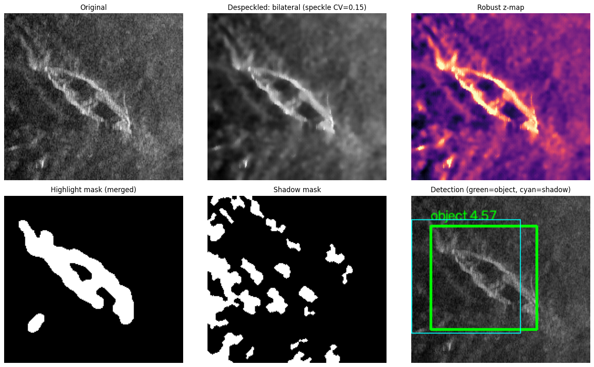
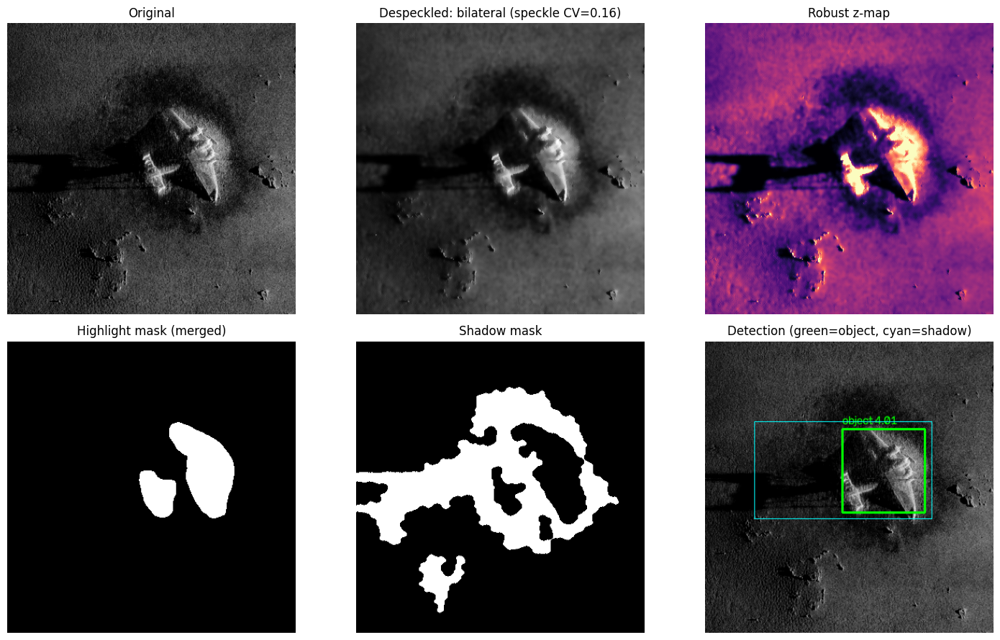
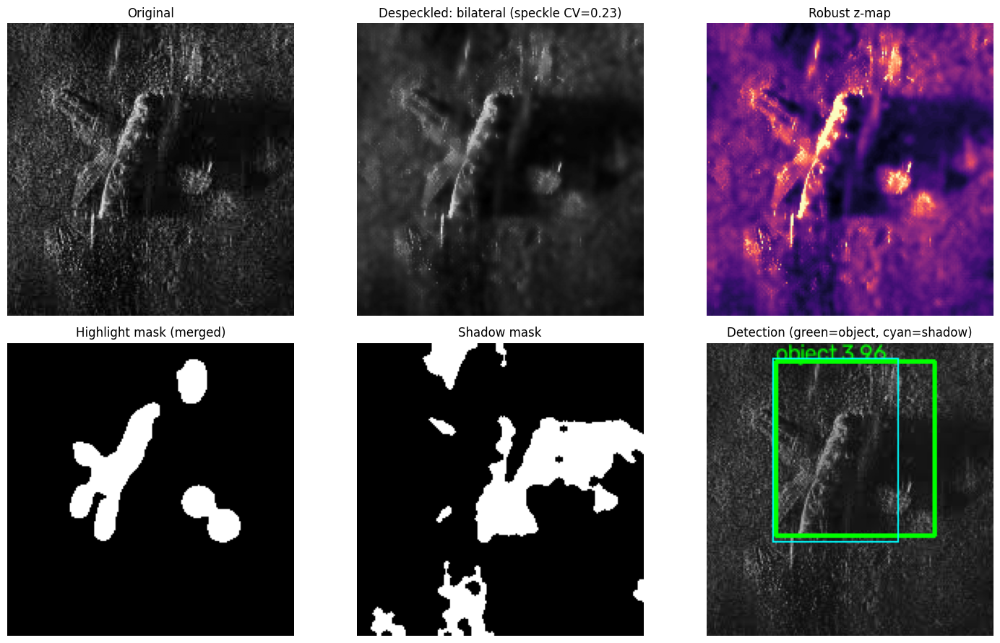
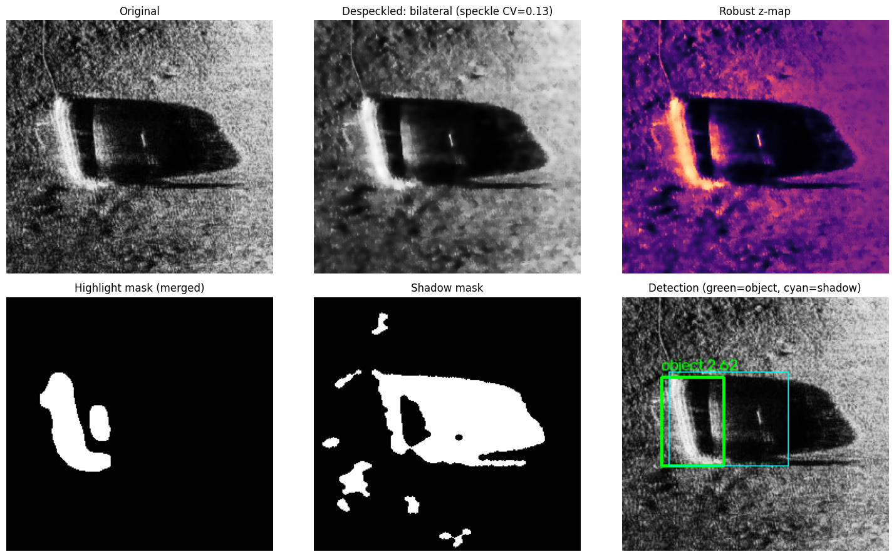
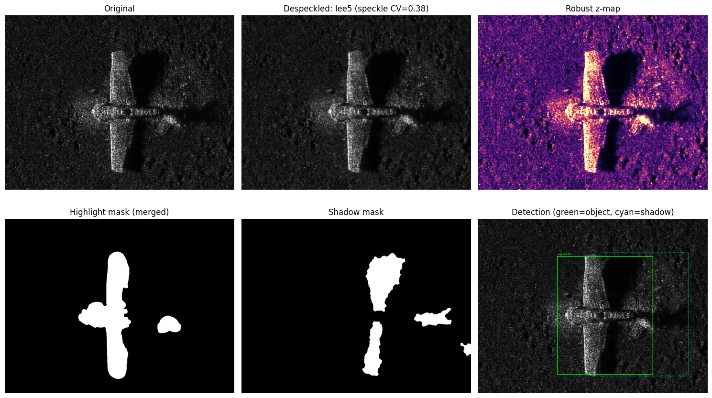
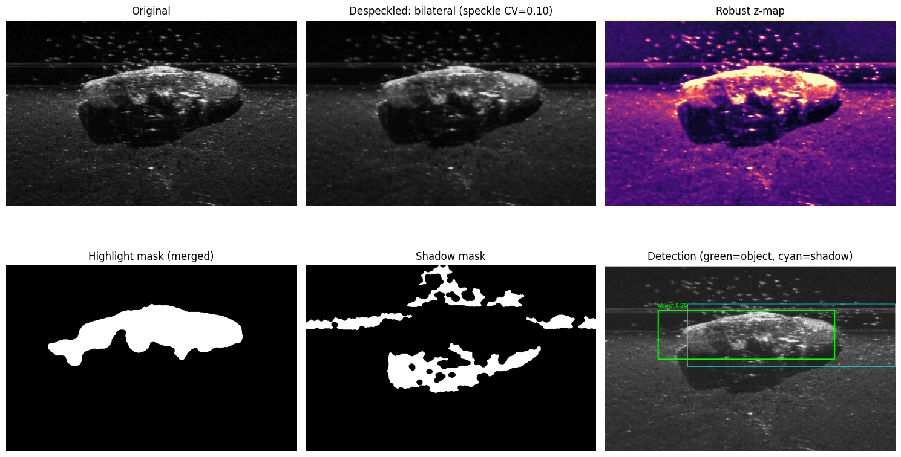
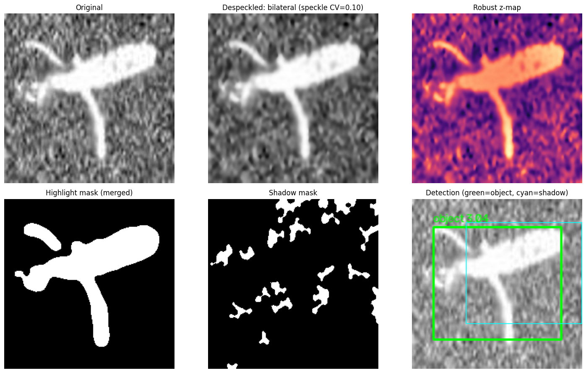

# Speckle-Adaptive Sonar Target Detection

Training-free detection of objects (ships, aircraft wrecks, mines) in side-scan sonar images, using range-consistent shadow validation. No labels, no deep learning, runs in milliseconds per image on CPU.



## Idea

Sonar images are corrupted by multiplicative speckle, and real objects cast an acoustic shadow along the range axis. This pipeline exploits both:

1. Estimate speckle level (coefficient of variation on the most homogeneous blocks)
2. Pick a despeckling filter from that estimate (bilateral, Lee 5x5, Lee 9x9, or NLM)
3. Flatten range gain and build a robust z-score map (median / MAD)
4. Build highlight and shadow masks, then clean up with morphology and a density-hysteresis step
5. Group highlight blobs into candidates and validate each one by finding a shadow on the range axis
6. Return the best box, with optional evaluation (IoU, precision, recall, F1) and ablation

## Project structure

```
.
├── sonar_detect.py        # full pipeline, CLI, evaluation, ablation
├── notebooks/demo.ipynb   # run the detector on sample images
├── results/               # output figures
├── data/                  # input images and gt.csv (not tracked)
├── requirements.txt
└── LICENSE
```

## Setup

```bash
git clone https://github.com/<your-username>/sonar-target-detection.git
cd sonar-target-detection
python -m venv .venv
source .venv/bin/activate        # Windows: .venv\Scripts\activate
pip install -r requirements.txt
```

## Usage

Single image:

```bash
python sonar_detect.py --image data/sonar.png --out result.png
```

Use `--axis vertical` if the range axis runs top to bottom.

Evaluation on a labelled folder (`gt.csv` columns: `filename,x1,y1,x2,y2`):

```bash
python sonar_detect.py --img_dir data/ --gt data/gt.csv
python sonar_detect.py --img_dir data/ --gt data/gt.csv --ablation
```

As a library:

```python
from sonar_detect import detect, load_gray, show, Cfg

res = detect(load_gray("data/sonar.png"), Cfg())
show(res, save="result.png")
print(res["dets"][0]["box"], res["speckle_cv"], res["filter_name"])
```

## Output

Each run produces a 6-panel figure: original, despeckled image, robust z-map, merged highlight mask, shadow mask, and final detection (green box = object, cyan box = validated shadow).

| | | |
|---|---|---|
|  |  |  |
|  |  |  |

## Key parameters

All set in the `Cfg` dataclass.

| Param | Default | Meaning |
|---|---|---|
| `filter_mode` | `adaptive` | `adaptive`, `none`, `bilateral`, `lee5`, `lee9`, `nlm` |
| `use_shadow` | `True` | shadow validation on or off (ablation) |
| `range_axis` | `horizontal` | direction shadows are cast |
| `kh`, `ks` | 2.0, 1.0 | highlight and shadow z thresholds |
| `refine` | `False` | grow the box over faint object parts |
| `topk` | 1 | number of detections returned |

## Limitations

- Filter cut-offs in `choose_filter` are heuristic and should be tuned on a validation split
- Assumes a roughly known range axis
- Returns top-k boxes, so multi-object scenes need `topk > 1`

## License

MIT
